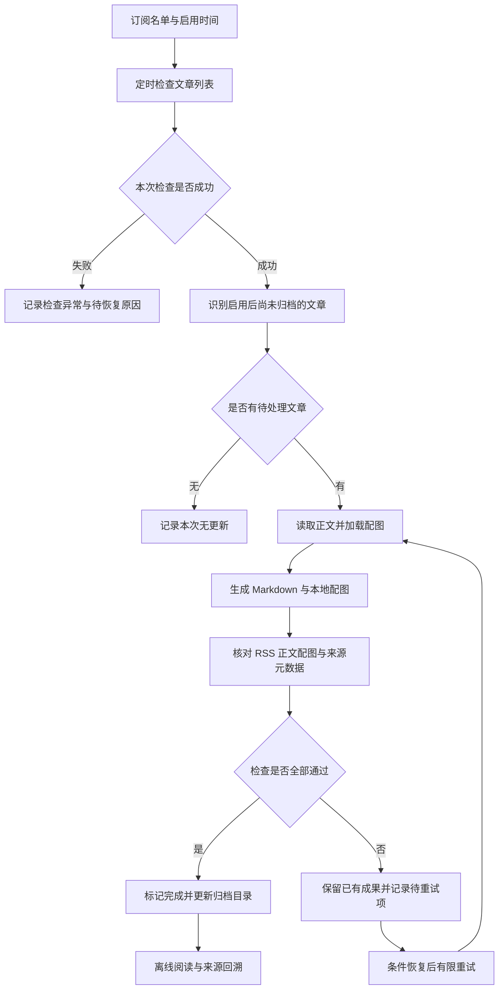

# 留墨产品设计

状态：用户确认 V1 先做猫笔刀单号，使用公开 RSS 发现并保存内容快照，接受群发范围、上游延迟和有限补抓窗口；不读取评论，原页截图与原文时间核实暂缓。2026-10-21 正式后台新增归档已通过，用户明确要求按该修订范围结项，见 [结项报告](/Users/chenge/project/liumo/docs/maobidao-mvp-closeout.md) 。后续任务与实际进度以 [ROADMAP.md](/Users/chenge/project/liumo/ROADMAP.md) 为准。

## 一页纸产品定义

**定位：** 为辰戈持续保存指定公众号启用后的新文章，形成能离线阅读、保留原貌、可追溯来源的个人文章档案。

| 项目 | 定义 | 状态 |
| --- | --- | --- |
| 名称与范围 | 留墨，项目名 `liumo`，独立项目；V1 自动追更猫笔刀单号，stormzhang 暂缓 | 用户最新确认 |
| 用户与痛点 | 个人日常阅读，希望持续保留文章，减少手动收集与导出 | 已确认 |
| 输入 | 自动入口为猫笔刀公开 RSS；显式 `save URL` 接收任意公众号公开文章链接 | 自动入口按首次发现暂存；链接入口独立读取可访问原文 |
| 核心处理 | 发现 RSS 新条目，保存来源提供的正文、配图与公开链接 | RSS 内容版已确认；不声称对照原文完整 |
| 文字产物 | Markdown，正文配图下载到本地并使用相对引用 | Markdown 与本地配图已确认；相对引用为建议 |
| 图片产物 | 当前只保存 RSS 配图到本地，原页单张整图暂缓 | 用户最新确认；不生成冒充原页的重排图 |
| 来源信息 | 标题、公众号标识与名称、发布时间、原链接、归档时间、内容校验值 | 建议 |
| 日常形态 | 当前 Mac 定时检查，本地文件阅读，本机通知；预留微信通知出口，当前不实现微信渠道 | 已确认；状态查看与重试入口形式待验证 |
| MVP 完成条件 | 猫笔刀 RSS 快照正文、配图、来源标签与状态完整，重复运行不重复归档、失败可恢复 | 修订范围验收通过；正式后台新增归档已补齐，可靠性长期观察独立 |
| 当前范围外 | 评论读取／回复／评论截图、自动补全启用前历史、当前微信通知实现；其他平台、AI 摘要问答、公开分享、多用户、多端同步、音视频归档 | 手动指定单篇不受发布时间限制；其余边界沿用 |

**使用流程：** 配置订阅与启用时间 → 自动检查和归档 → 按公众号、日期回看文件 → 发生异常时查看原因并恢复任务。

**价值验证：** 建议连续试用约 14 天，人工对照实际发布记录，核对新文章发现率、完整归档情况和人工维护耗时。没有实际新增文章的日期只能验证无更新行为；试用通过仍不代表长期零漏存。

## 手动链接补存

用户明确确认新增任意微信公众号文章链接立即归档，独立于已结项的猫笔刀自动追更范围。`save URL` 通过正常项目浏览器读取可见图文正文，保存 Markdown、本地配图及公开身份；不使用 RSS 代替原文，也不增加自动订阅。默认复用经文件校验的已有手动快照，显式刷新保留新版本，手动失败不改变自动追更位置。

手动结果标记 `manual_page_snapshot`，RSS 结果沿用 `rss_snapshot`。两者都不包含评论或原页截图；手动保存只有原文时间与页面日期相符才标记已核实。正常访问受限时只允许用户正常验证，不绕过访问控制。实现、数据目录、预算和限制见 [链接归档说明](/Users/chenge/project/liumo/docs/manual-archive.md) ，验收见 [本轮施工清单](/Users/chenge/project/liumo/goals/20261022-0800-manual-url-archive.md) 。真实单篇通过不代表所有公众号和页面版式均通过。

## 数据流图

新文章发现与单篇归档分别负责列表获取、正文和产物处理。检查失败不进入「无更新」分支；存在未完成文章时，也不能用「无新增」掩盖其状态。当前快照保存 RSS 提供的内容，原页截图暂缓。

## 当前存储与状态

- 正式快照在 `archives/maobidao/<article-key>/<attempt-id>/`，SQLite 在 `state/maobidao/`。每次尝试新目录，已有快照不覆盖；正文、图片及元数据可独立复制阅读。
- 身份由公开链接的固定猫笔刀 biz／mid／idx 规范化，标题与内容哈希不承担唯一去重。RSS 正文变化记录提示，不覆盖已经保存的旧快照。
- 发现候选先持久化，处理与完成分开。首次观察时间在重试时不变；初始化列表只建基线。任务失败后即使已经滑出当前 RSS 窗口，仍可从本地保留的输入恢复。
- 当前 `complete` 只对应 `archive_kind=rss_snapshot`，不是原站归档。元数据标记原文时间未核实、截图 `deferred`、评论 `not_requested`；RSS 时间仅作候选。上游晚到的旧发布可能在启用后首次发现，用户已接受先暂存的语义。
- 普通图片／写盘等失败最多自动尝试 3 次，之后保留并等待显式 retry；来源格式／访问拒绝暂停，不循环探测。完成产物、部分成果、原站旧失败证据分别保留。

## 当前运行与范围

1. 当前 Mac，固定 `Asia/Shanghai` 四个时点：22:00、22:30、23:00、23:30。错过多次合并，网络／服务失败退避 15 分钟至最多 6 小时，在窗口外到期也可补查；恢复可见前存在退避延迟。
2. 本机通知保留一个普通函数出口，通知失败不回滚状态；未实现微信通知。无新增不弹窗，已有失败不会被无新增掩盖。
3. 默认运行只读公开 RSS 与其明示的腾讯图片，不读应用会话、不扫码、不打开微信文章。原页诊断只保留为显式历史入口，当前不再尝试。
4. 用户后续确认安装后台任务，当前专用 LaunchAgent 已加载，真实日历心跳、停用／恢复和正式夜间新增归档通过；不改系统时区。原文时间与原页截图仍暂缓，实际唤醒／休眠与长期可靠性另验。[后台运行说明](/Users/chenge/project/liumo/docs/maobidao-scheduler.md) 。
5. 第三方源通常存在 0～24 小时更新延迟，受限可能更久；只覆盖其群发与可访问窗口，不承诺长期零漏存。

## 当前技术路线与验收

采用标准库 SQLite、已有 Markdown／图片工具与上海时区门控。新增 `liumo/` 提供单号 RSS、快照、任务状态和 CLI；不复制上游代码、不搭建插件框架、不新增依赖。原页尝试因验证异常失败后用户明确同意 RSS 内容版，真实快照《撒钱100亿》的正文与 6 张配图已保存；原站未验证事实不改写。最小运行与限制见 [MVP 使用说明](/Users/chenge/project/liumo/docs/maobidao-mvp.md) ，施工见 [当前清单](/Users/chenge/project/liumo/goal/20261019-2328-maobidao-mvp.md) 。

## 历史技术路线与证据记录

以下为此前含评论目标下的决策与实验记录，现已退出 V1 执行主线；其中的“当前”“下一步”和评论门槛仅描述当时状态，不构成新的执行指令。最新范围及顺序以上节与 Roadmap 为准。旧失败不追溯改为通过，专项恢复边界继续保留。

下表均为设计候选，不表示已经定案或全部运行通过；已开展的调研及分项证据见可行性结论与 Roadmap。2026-10-17 的 [GitHub 方案调研](/Users/chenge/project/liumo/docs/github-solutions.md) 补充了旧后台工具停维护、微信读书仅最新一篇限制报告及评论凭证边界；撤回微信读书优先验证建议。微信读书不是正文获取的必需依赖，HTTP 正文、评论数据与原页完整截图须分别验收；不以接口重建页面自动替代原页截图。

同日 [exporter 机制研究](/Users/chenge/project/liumo/docs/exporter-mechanism.md) 进一步定位主下载器的留言游标与回复补取。用户现已确认按该推荐路线实施：沿用现有 Python 与浏览器组件，代码全部自行编写，只借鉴协议与实现思路；实现小规模串行 HTTP、独立本地配图、首次评论快照与原页截图，不整体移植其前端、公共代理池或多格式导出。这是实施路线确认，不是来源可用性确认；多篇覆盖、凭证持续性和原页截图访问条件仍待真实证据。现有无凭证 HTTP 已返回限制页，不机械重复；先完成独立代码与构造验证。

当前 [本机凭证实验提案](/Users/chenge/project/liumo/docs/wechat-session-operations.md) 以有限时本地 HTTPS 代理为候选。用户明确批准的一次最多 10 分钟实验已取得两号候选并完成正常恢复；使用有效性、持续自动取得与自然续期仍未通过。该候选不是已选定的产品常驻依赖，也不能以接口评论数据替代含评论原页单图。

普通终端基线已证明当前 Mac 存在已启用的本机原代理，实验须衔接并保留其配置，不能假定“原来无代理”。2026-10-17 的一次真实实验已通过主机限定信任、代理往返、两号候选凭证保存及正常收尾恢复；两号随后列表均为 source_shape_changed，功能有效性尚未通过。用户首次正常打开两篇样本已经完成，不再重复要求；这不证明日后可无人值守刷新。[现场证据与后续缺口](/Users/chenge/project/liumo/docs/wechat-session-validation.md) 。

同日普通终端诊断确认两号 ret=0／can_msg_continue=0，但文章列表字段缺失，不能补成“无更新”。后续自主实测：两篇带凭证正文在 302 处停止；对齐固定参考显式头部后，两号列表各一次为 HTTP 200／业务码 -3；主页前置检查未识别到目标号身份或新会话字段，未继续列表。当前 Credential 来源未通过选型，不重复复用旧候选，也不据此认定接口永久关闭、凭证过期或重新登录一定可解。正文／评论与原页程序已有失败保护，尚无本轮完整真实归档；不以手动链接替代自动发现。[当前技术证据](/Users/chenge/project/liumo/evidence/feasibility/wechat-autonomous-validation.json) 。

后续 C7 已由用户单独授权，新增两号正常主页／列表的最小字段采集与每号一次即时核对，使用独立实验目录和恢复入口。程序和自测已交付，用户普通终端已执行到期，本次主机约束、原值往返及最终恢复通过；未匹配到目标请求，没有即时探针，功能未通过。用户已补正常主页可见反馈及截图，当前卡点为请求路径／阶段未定位；菜单截图未暴露地址，已准备 120 秒无凭证控制诊断与自测，第三次单次限定实验已结束：控制 HTTP 200 且代理控制请求／响应各 1 次，普通目标域 HTTP 计数为 0、客户端 TLS 失败 91 次；系统恢复与进程停止通过，具体握手原因和客户端归属未知，不重启实验。不据此判定平台不可用，也不把诊断控制通过等同功能会话可用。该实验不改变产品边界、不采用第三方常驻服务，也不证明 Mac 微信在线即可无人值守刷新。[当前阶段](/Users/chenge/project/liumo/docs/wechat-session-validation.md) 。

2026-10-18 11:49：C10 已完成一次 Agent 控制的主页重载与正常系统恢复：控制通过，主页图片恢复、互动数字变化，但普通目标域 HTTP 始终为 0。唯一证书告警在刷新前且无后续增量，不能据此判定客户端证书固定、该次刷新被拒或实际通道。当前有限代理实验未建立主页列表会话，不作为常驻来源。[C10 现场证据](/Users/chenge/project/liumo/evidence/feasibility/wechat-ui-diagnostic-live.json) 。

2026-10-18 11:56：C11 只读复核确认 wxdown 固定插件以文章页为对象，exporter 列表封装不负责当前 Mac 主页初始化；两者不能证明本机 4.1.15／270100 的主页路径。上游要求 HTTP／HTTPS 双代理及系统级信任，留墨只改 HTTPS、采用用户级主机限定信任；差异已知，失败根因未定，不自动放宽。暂停原样主页重试；后续文章对照实验或后台来源路线须满足各自前提，均未选定或通过。产品完整要求保留。[通道复核](/Users/chenge/project/liumo/docs/wechat-profile-route-review.md) 。

2026-10-18 12:26：C12 单次文章对照已结束并正常恢复。控制 HTTP 200、代理控制计数各 1；Agent 于 12:22:02 一次刷新猫笔刀样本后，页面出现 NET::ERR_CERT_AUTHORITY_INVALID，目标 certificate_alert 从 0 增至 15，文章／普通目标 HTTP 仍为 0。代理恢复回读、临时信任撤销和进程停止通过，未采凭证、未发列表／评论探针。当前配置未被文章浏览器接受；主机限定信任的 Chromium 兼容性仅为源码支持的假设，尚非微信根因证明。不重跑本次实验，原 Goal 未完成。[现场证据](/Users/chenge/project/liumo/evidence/feasibility/wechat-article-diagnostic-live.json) 。

2026-10-18 12:38：C13 离线证书探针已交付。OpenSSL 3.6.3 下改进候选的 17 个场景符合预期，朴素 DNS 许可方案有 7 个范围遗漏；macOS 显式根正对照退出 1、含 CT／SCT 提示，未执行后续矩阵，不算约束通过。198 项回归为 194 通过、4 跳过。未安装信任、改代理、访问微信或保留私钥；没有新增微信功能通过项。整体 partial，原 Goal 仍 blocked、未完成。[离线报告](/Users/chenge/project/liumo/docs/certificate-scope-offline.md) 、[证据](/Users/chenge/project/liumo/evidence/feasibility/certificate-scope-offline.json) 。

2026-10-18 14:45：已核对普通终端 C14 离线结果。macOS 正对照退出 0、信任结果 4，CT 提示与成功决定并存；两个验证器各 51 项均取得结果，改进候选各 17 项符合预期，朴素方案各有 7 个范围遗漏。未安装信任、改代理或访问微信。程序／测试 38 份哈希与 200 项回归基线一致，未重复运行。显式根结果不等于安装后信任或微信兼容；新证书亦使本次不能单独证明旧 Agent 内部错误的根因。该离线检查点完成，原 Goal 仍 blocked、未完成。[终端证据](/Users/chenge/project/liumo/evidence/feasibility/native-control-terminal.json) 。

2026-10-18 15:14：C15 普通终端安装后 17 项约束通过；后续独立恢复已取得证书不存在及带根链目标明确不信任 （-67843／信任结果 5），本次有效撤销验收通过，无需继续运行命令。撤销验收在信任开始 125.8 秒后完成，原 120 秒自动收尾未通过，不补记为成功。已修正自动／独立撤销各命令 30 秒认证预算，并将自动流程收尾预留增至 70 秒；216 项回归为 212 通过、4 跳过。预算修正仅经构造测试，未重装或重跑系统实验。微信兼容、无人值守追更及原 Goal 仍未完成。[现场证据](/Users/chenge/project/liumo/evidence/feasibility/installed-anchor-live.json) 。

2026-10-18 18:47：C20 普通终端取得 HTTP 200、3493257 字节正文，完整传输及号／文章／标题的独立 HTML 身份门槛通过；这份响应约 3.33 MiB，确实超过旧 2 MiB 预算，但不能反推旧 56／302 根因或证明 Cookie 必需。评论请求 HTTP 200／业务码 -3，快照失败、保存 0 条，整体 partial；不是文章无留言。正文／评论各 1 次已消耗，旧结果保全，不再复用该候选重试。本次只保存功能摘要与失败评论快照，未保存 HTML 或生成 Markdown／本地配图／原页截图。离线 18 项评论 query 语义及 UA 与固定参考一致，当前 token 无百分号解码差异；完整 Cookie、响应 Cookie 更新及正常微信成功评论请求仍无对照，-3 原因未知。50 份代码哈希符合 268 项基线，未重复测试；原 Goal 仍 blocked、未完成。[真实证据](/Users/chenge/project/liumo/evidence/feasibility/article-cookie-body-live.json) 。

2026-10-18 16:08：C16 单次文章兼容与限时收尾通过。普通终端启动后，安装前对照／不信任及安装后 17 项范围检查成立；控制 HTTP 200、代理控制计数各 1。Agent 对猫笔刀固定文章正常刷新一次，页面可读且未见证书警告；文章请求／响应从 0 增至各 1，普通目标域从 0 增至各 20，TLS 失败计数均为 0。约 60.3 秒完成代理回读恢复、明确有效撤销、进程停止及两份私钥删除，180 秒窗口内收尾通过。未采凭证或发列表／评论探针，不证明旧错误的唯一根因、两号兼容或凭证功能；236 项基线哈希未变，未重复运行代码测试。C16 已关闭，不重跑；原 Goal 未完成。[真实证据](/Users/chenge/project/liumo/evidence/feasibility/wechat-compat-live.json) 。

当前评论对照采用 C21 限定被动基线：仅正常微信固定样本的一条成功留言响应，记录必要私有条件后离线比较，不自动重放。实现与构造回归已交付；本次 C21 已执行并完成正常恢复：留言与回复可见，但匹配评论响应 0，未保存 Cookie 或成功基线。刷新快捷键未取得文章请求增量，原因未知，不能据此调整协议；C21 已关闭不重跑，-3 原因仍未确定。这不改变评论／回复与原页整张截图的验收要求。[具体边界](/Users/chenge/project/liumo/docs/comment-baseline-validation.md) 。

C22 明确刷新对照已完成并正常恢复：用户一次圆形箭头刷新后，有文章类 HTTP 及互动数字变化，页面留言／作者回复可见；已知评论路径分类计数仍全为 0，未取得 Cookie 或成功基线。当前需要静态核对评论加载逻辑，不能把旧 exporter 的端点自动视为当前 Mac 的实际通道，也不能据此认定具体替代路径或旧 -3 根因。C22 已关闭不重跑，完整截图与自动追更要求保持。[真实证据](/Users/chenge/project/liumo/evidence/feasibility/comment-refresh-live.json) 。

C26 正常微信被动响应已实测：HTTP 200／gzip，两条 Content-Type 完整归一化等价，解码 HTML 为 3493845 字节，独立文章身份通过；16.313 秒内四项系统恢复通过。只保留固定摘要，原始 HTML 未落盘。57 个 script 中两条外部来源均被白名单拒绝，没有可用公共脚本地址；固定标记词频不能证明评论调用关系，静态取证整体 partial，评论和原页完整归档仍未通过。C24／C25 的原始头部未保留，不能由 C26 倒推旧失败原因。下一步建议以内存语法树区分内联脚本的字符串与调用，仅作静态线索；C27 组件及离线 JS 分析已通过；C28 的身份后 HTML 连接、覆盖／来源固定分类和本次 Node 子进程组收尾已完成构造验证，完整回归 355 项为 351 通过、4 跳过。C28 已取得真实 HTML 身份及 53 段经典／2 段 module／2 条已知主机路径拒绝的范围，AST 触发本地 20 万节点上限，整体 partial；14.705 秒内恢复通过。离线构造容量候选通过不等于真实脚本通过，峰值 RSS 未验。建议下一轮允许单份固定 HTML 的本机私有保留以支持复核；这是待用户确认的数据范围变更，当前仍只允许内存，未创建新授权或采集。[真实证据](/Users/chenge/project/liumo/evidence/feasibility/article-static-duplicates-live.json) 、[排查与下一步](/Users/chenge/project/liumo/docs/comment-loading-investigation.md) 。

| 环节 | 当前倾向 | 定案前需要的证据 |
| --- | --- | --- |
| 主程序 | Python；用户确认自研实现，参考 exporter 的协议思路 | 本机环境、追更来源接入方式和必要依赖可用 |
| 页面与截图 | Playwright | 正文、懒加载配图、评论、回复、附属区域和底部均可核对，单张截图无截断 |
| 内容存储 | 本地文件 | Markdown 和图片可移动、可离线打开、可恢复 |
| 任务状态 | 文件优先；必要时 SQLite | 重试、断点恢复和串行写入可正确实现 |
| 定时调度 | Mac 系统调度与北京时间门控 | 先生成可审阅配置，验证恢复合并与时区；本 Goal 不安装或加载系统后台任务 |
| 新文章发现 | 暂不指定工具或接口 | 当前可用性、平台规则、登录需求与维护负担已核实 |

首个 Goal 先比较最多三条来源路线并尽早做含评论单篇验证，再核对增量与调度。仅返回最新一篇不能通过完整追更，RSS 时间不能未经核对代替原文发布时间。源码、文档与模拟证据均不等于真实来源验证。动态结论需一手链接、访问日期；源码需版本或提交位置。具体证据与结论汇总到 `docs/feasibility.md`，施工范围见 [Goal 清单](/Users/chenge/project/liumo/goals/20261016-2359-feasibility.md) 。

## 方法依据

以下为归墟中的方法参考，不是 liumo 的实现或外部接口可用性证据。本文的产品与架构建议由这些方法结合本次需求推导。

- [产品思维](/Users/chenge/project/guixu/notes/2026-07-07-ai-learning-practice-kb-02-product-thinking.md) ：真实痛点、一页纸 MVP、完整价值流与短期真实使用验证。
- [架构思维](/Users/chenge/project/guixu/notes/2026-07-07-ai-learning-practice-kb-03-architecture-thinking.md) ：先倒推使用场景，再明确「进、存、取」；数据流与工具选择分开。
- [技术思维](/Users/chenge/project/guixu/notes/2026-07-07-ai-learning-practice-kb-04-technology-thinking.md) ：主流、本地、文件优先、成熟工具优先，具体渠道需重新核实。
- [Agentic Coding 实战](/Users/chenge/project/guixu/notes/2026-07-07-ai-learning-practice-kb-06-agentic-coding.md) ：提供设计上下文、分步实现、逐步验收，重复机械工作落成程序。
